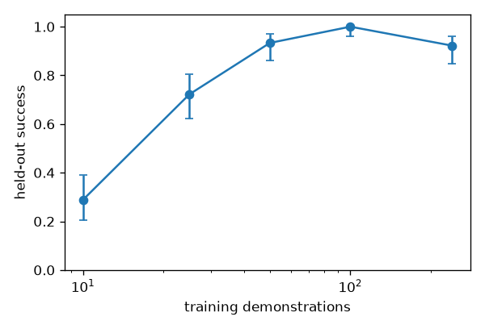
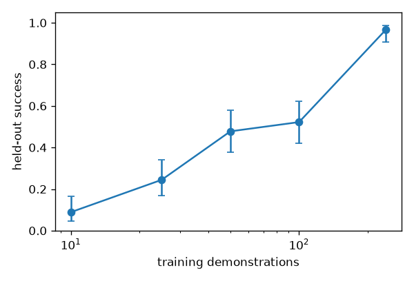

<!-- generated by scripts/make_report.py from logged results; do not edit -->

## Accuracy: controller v1 (baseline) vs v2 (waist-assisted IK + delta actions)

v1 = RoboSuite default IK posture weights, absolute-target actions. v2 = waist posture weight 1 + delta actions. **Not like-for-like for reach and place**: v2 also uses stricter success rules (reach 3 cm + 5-step hold vs 5 cm; place radius 3 cm vs 4.5 cm). Errors are final-pose means over the same 30 held-out instance seeds.

| task | policy | v1 success [Wilson 95%] | v2 success [Wilson 95%] | v1 hand err (cm) | v2 hand err (cm) | v1 place err (cm) | v2 place err (cm, max) |
|---|---|---|---|---|---|---|---|
| pick_up_cup | scripted expert | 96.7% [83.3%, 99.4%] | 100.0% [88.6%, 100.0%] | 2.26 | 0.64 | - | - |
| pick_up_cup | BC-MLP | 100.0% [88.6%, 100.0%] | 100.0% [88.6%, 100.0%] | 1.76 | 0.50 | - | - |
| place_cup | scripted expert | 96.7% [83.3%, 99.4%] | 100.0% [88.6%, 100.0%] | 5.66 | 1.91 | 3.87 | 0.44 (0.52) |
| place_cup | BC-MLP | 93.3% [78.7%, 98.2%] | 100.0% [88.6%, 100.0%] | 5.27 | 1.79 | 3.33 | 0.70 (2.22) |
| reach_cup | scripted expert | 100.0% [88.6%, 100.0%] | 100.0% [88.6%, 100.0%] | 4.75 | 1.32 | - | - |
| reach_cup | BC-MLP | 70.0% [52.1%, 83.3%] | 100.0% [88.6%, 100.0%] | 7.67 | 1.33 | - | - |
| pick_up_cup | bc_mlp_v2_pick_up_cup_s0 (v2 only) | - | 13.3% [5.3%, 29.7%] | - | 7.85 | - | - |
| pick_up_cup | diffusion_v2d_pick_up_cup_s0 (v2 only) | - | 73.3% [55.6%, 85.8%] | - | 4.77 | - | - |

Scripted expert over a grid of cup positions (deterministic positions across the spawn region):

| task | v1 | v2 |
|---|---|---|
| pick_up_cup | 81% over 21 pts | 100% over 21 pts |
| place_cup | - | 100% over 9 pts |
| reach_cup | - | 100% over 9 pts |

## IK waist posture weight scan (scripted pick at 4 previously failing corners + 2 easy points)

| waist weight (yaw=pitch) | expert success | mean hand error (m) | max waist yaw (rad) | max waist pitch (rad) |
|---|---|---|---|---|
| 10 (RoboSuite default, v1) | 33% | 0.102 | 0.23 | 0.50 |
| 5 | 100% | 0.009 | 0.31 | 0.58 |
| 3 | 100% | 0.007 | 0.36 | 0.63 |
| 2 | 100% | 0.007 | 0.38 | 0.65 |
| 1 (v2 default) | 100% | 0.007 | 0.40 | 0.68 |

## Scene-level generalisation (10 train / 3 val / 5 held-out test scenes; 10 episodes per scene)

| controller / policy | train scenes | val scenes | held-out test scenes | gap (train - test) |
|---|---|---|---|---|
| v1: bc_multiscene | 72.0% [62.5%, 79.9%] n=100 | 66.7% [48.8%, 80.8%] n=30 | 62.0% [48.2%, 74.1%] n=50 | +10.0% |
| v1: bc_singlescene | 0.0% [0.0%, 3.7%] n=100 | 0.0% [0.0%, 11.4%] n=30 | 0.0% [0.0%, 7.1%] n=50 | +0.0% |
| v1: scripted_expert | 85.0% [76.7%, 90.7%] n=100 | 76.7% [59.1%, 88.2%] n=30 | 88.0% [76.2%, 94.4%] n=50 | -3.0% |
| v2: bc_multiscene | 100.0% [96.3%, 100.0%] n=100 | 96.7% [83.3%, 99.4%] n=30 | 80.0% [67.0%, 88.8%] n=50 | +20.0% |
| v2: bc_singlescene | 10.0% [5.5%, 17.4%] n=100 | 0.0% [0.0%, 11.4%] n=30 | 0.0% [0.0%, 7.1%] n=50 | +10.0% |
| v2: scripted_expert | 100.0% [96.3%, 100.0%] n=100 | 100.0% [88.6%, 100.0%] n=30 | 100.0% [92.9%, 100.0%] n=50 | +0.0% |
| v2: multi-scene BC, placement-goal inputs removed | 100.0% [96.3%, 100.0%] n=100 | 100.0% [88.6%, 100.0%] n=30 | 100.0% [92.9%, 100.0%] n=50 | +0.0% |

## Multi-item household tasks (clear_table, load_dishwasher, laundry_basket)

Rigid-body proxies on the same GR1 right-hand pick-and-place stack: items are cylinders (cups / laundry rolls), receptacles are static (tray, counter-top dishwasher rack without door or sliding, tote with end rims); cloth is not simulated. Success = every item placed on its slot (within 3 cm, upright, settled, hand released) and still there at the end, with at most 5 invalid contact steps. State observations (privileged item pose), delta actions, 100 expert demos, held-out seeds 900000+ (30 episodes per row).

| task | policy | seed | success [Wilson 95%] | mean items placed | mean steps |
|---|---|---|---|---|---|
| clear_table | scripted_expert | - | 93.3% [78.7%, 98.2%] | 2.93 | 667 |
| clear_table | bc_mlp | 0 | 63.3% [45.5%, 78.1%] | 2.47 | 789 |
| clear_table | bc_mlp | 1 | 76.7% [59.1%, 88.2%] | 2.57 | 729 |
| clear_table | bc_mlp | 2 | 93.3% [78.7%, 98.2%] | 2.97 | 690 |
| laundry_basket | scripted_expert | - | 100.0% [88.6%, 100.0%] | 3.00 | 638 |
| laundry_basket | bc_mlp | 0 | 96.7% [83.3%, 99.4%] | 2.90 | 646 |
| laundry_basket | bc_mlp | 1 | 83.3% [66.4%, 92.7%] | 2.80 | 698 |
| laundry_basket | bc_mlp | 2 | 90.0% [74.4%, 96.5%] | 2.70 | 683 |
| load_dishwasher | scripted_expert | - | 100.0% [88.6%, 100.0%] | 2.00 | 410 |
| load_dishwasher | bc_mlp | 0 | 96.7% [83.3%, 99.4%] | 1.97 | 386 |
| load_dishwasher | bc_mlp | 1 | 93.3% [78.7%, 98.2%] | 2.00 | 400 |
| load_dishwasher | bc_mlp | 2 | 96.7% [83.3%, 99.4%] | 1.97 | 388 |

Pooled over BC seeds:

| task | BC seeds | pooled success [Wilson 95%] |
|---|---|---|
| clear_table | 3 | 77.8% [68.2%, 85.1%] (n=90) |
| laundry_basket | 3 | 90.0% [82.1%, 94.6%] (n=90) |
| load_dishwasher | 3 | 95.6% [89.1%, 98.3%] (n=90) |

## Experiments re-run on controller v2 (delta actions, 30 held-out episodes per run)

### Data scaling (BC-MLP, state obs, 3 seeds)

| demos | per-seed success | mean val-MSE | pooled success [Wilson 95%] |
|---|---|---|---|
| 10 | 27%, 20%, 40% | 0.03677 | 28.9% [20.5%, 39.0%] (n=90) |
| 25 | 80%, 93%, 43% | 0.03146 | 72.2% [62.2%, 80.4%] (n=90) |
| 50 | 97%, 100%, 83% | 0.02666 | 93.3% [86.2%, 96.9%] (n=90) |
| 100 | 100%, 100%, 100% | 0.02211 | 100.0% [95.9%, 100.0%] (n=90) |
| 240 | 100%, 97%, 80% | 0.01974 | 92.2% [84.8%, 96.2%] (n=90) |



### Diffusion inference steps (same checkpoint; success only, latency in its own table)

| DDIM steps | success [Wilson 95%] |
|---|---|
| 1 | 0.0% [0.0%, 11.4%] |
| 2 | 0.0% [0.0%, 11.4%] |
| 5 | 83.3% [66.4%, 92.7%] |
| 10 | 73.3% [55.6%, 85.8%] |
| 20 | 63.3% [45.5%, 78.1%] |

### Policy inference latency (policy only, 1 torch thread, other jobs running; min / median of repeats)

| policy | DDIM steps | min ms per call | median ms | min ms per env step |
|---|---|---|---|---|
| bc_mlp | - | 0.45 | 0.49 | 0.45 |
| diffusion | 1 | 9.05 | 11.93 | 1.13 |
| diffusion | 2 | 15.74 | 17.30 | 1.97 |
| diffusion | 5 | 41.75 | 50.24 | 5.22 |
| diffusion | 10 | 84.75 | 96.15 | 10.59 |
| diffusion | 20 | 174.81 | 201.09 | 21.85 |

A diffusion plan covers 8 control steps, so the per-env-step column divides by 8. CPU only; no GPU claim.

### Proprio-only control (no cup information)

| seed | success [Wilson 95%] |
|---|---|
| 0 | 26.7% [14.2%, 44.4%] |
| 1 | 23.3% [11.8%, 40.9%] |
| 2 | 16.7% [7.3%, 33.6%] |

### Image policy (CNN-BC, 64x64 RGB + proprio, 150 demos, 40 epochs)

A trainer bug (action_mode not saved in CNN checkpoints) made the first evaluation read 0% everywhere; the numbers below are the corrected re-evaluation.

| trained on | tested on | success [Wilson 95%] |
|---|---|---|
| none | none | 13.3% [5.3%, 29.7%] (n=30) |
| none | visual | 13.3% [5.3%, 29.7%] (n=30) |
| visual | none | 23.3% [11.8%, 40.9%] (n=30) |
| visual | visual | 20.0% [9.5%, 37.3%] (n=30) |

### Curriculum (PPO, reach_cup, ee_delta, 30k steps each)

| curriculum | seed | held-out success [Wilson 95%] |
|---|---|---|
| fixed | 0 | 3.3% [0.6%, 16.7%] |
| fixed | 1 | 3.3% [0.6%, 16.7%] |
| manual | 0 | 0.0% [0.0%, 11.4%] |
| manual | 1 | 3.3% [0.6%, 16.7%] |
| adaptive | 0 | 0.0% [0.0%, 11.4%] |
| adaptive | 1 | 3.3% [0.6%, 16.7%] |

## Datasets

| dataset | episodes | steps | mean len | splits (train/val/test) | SHA-256 (first 12) | replay-verified |
|---|---|---|---|---|---|---|
| clear_table | 100 | 63022 | 630 | 80/10/10 | 5809168f5a7c | 2/2 |
| laundry_basket | 100 | 63722 | 637 | 80/10/10 | 4b548deece8c | 1/2 |
| load_dishwasher | 100 | 40422 | 404 | 80/10/10 | 92ad804971ea | 2/2 |
| pick_dr_combined | 300 | 30503 | 102 | 240/30/30 | 1d40b193872a | 0/0 |
| pick_dr_combined_v2raw | 150 | 15052 | 100 | 120/15/15 | 1c8ca12e49c3 | 0/0 |
| pick_dr_physics | 300 | 30441 | 101 | 240/30/30 | 42be45ed4b87 | 0/0 |
| pick_dr_physics_v2raw | 150 | 15059 | 100 | 120/15/15 | 08a7c7168d74 | 0/0 |
| pick_dr_sensor | 300 | 30452 | 102 | 240/30/30 | 72ff17e5cd8a | 0/0 |
| pick_dr_sensor_v2raw | 150 | 15053 | 100 | 120/15/15 | cca03ba83adc | 0/0 |
| pick_up_cup | 300 | 30292 | 101 | 240/30/30 | de4d7fdf26fc | 3/3 |
| pick_up_cup_rgb64 (rendered: rgb 64px, dr=None) | 130 | 13321 | - | - | 5d6743ca39f1 | - |
| pick_up_cup_rgb64_visdr (rendered: rgb 64px, dr=visual) | 130 | 13321 | - | - | ce3e84747e7c | - |
| pick_up_cup_v1 | 300 | 30653 | 102 | 240/30/30 | c0173c00a4b7 | 5/5 |
| pick_v2_rgb64 (rendered: rgb 64px, dr=None) | 180 | 18166 | - | - | 8121aac1069e | - |
| pick_v2_rgb64_visdr (rendered: rgb 64px, dr=visual) | 180 | 18166 | - | - | b9c740f3b72d | - |
| place_cup | 200 | 38367 | 192 | 160/20/20 | cbf0a7c3f021 | 3/3 |
| place_cup_v1 | 200 | 39050 | 195 | 160/20/20 | 19daed9667c5 | 3/3 |
| reach_cup | 300 | 16657 | 56 | 240/30/30 | b0486f940f5b | 3/3 |
| reach_cup_v1 | 100 | 5066 | 51 | 80/10/10 | 79c30e5779d7 | 3/3 |
| scenes_pick | 325 | 33053 | 102 | 261/32/32 | 7dc9b735960e | 4/4 |
| scenes_pick_v2 | 325 | 32842 | 101 | 261/32/32 | d26782b9f7d1 | 4/4 |

## Training runs (all logged)

| run | dataset demos | epochs / steps | duration (s) | best val | held-out success [Wilson 95%] | latency ms | checkpoint SHA-256 |
|---|---|---|---|---|---|---|---|
| bc_cnn_rgb_none_n100_s0 | 100 | 40 | 4134.8 | 0.00341 | - | - | 163d9f5862ee |
| bc_cnn_v2_none_n150_s0 | 150 | 40 | 4222.1 | 0.02381 | - | - | a79b3000cdf8 |
| bc_cnn_v2_visual_n150_s0 | 150 | 40 | 3817.8 | 0.02408 | - | - | e26355fbf90a |
| bc_mlp_clear_table_n100_s0 | 80 | 150 | 986.2 | 0.01963 | - | - | 1c20c541459f |
| bc_mlp_clear_table_n100_s1 | 80 | 150 | 1333.6 | 0.01970 | - | - | 429c8cf75200 |
| bc_mlp_clear_table_n100_s2 | 80 | 150 | 946.7 | 0.01952 | - | - | b6d02b5a93e5 |
| bc_mlp_laundry_basket_n100_s0 | 80 | 150 | 661.7 | 0.01922 | - | - | eaa3970e6850 |
| bc_mlp_laundry_basket_n100_s1 | 80 | 150 | 851.8 | 0.01911 | - | - | d3b701374e97 |
| bc_mlp_laundry_basket_n100_s2 | 80 | 150 | 597.8 | 0.01906 | - | - | f49ff1eee4dd |
| bc_mlp_load_dishwasher_n100_s0 | 80 | 141 | 378.6 | 0.02150 | - | - | f24bf2aa2c82 |
| bc_mlp_load_dishwasher_n100_s1 | 80 | 101 | 397.6 | 0.02108 | - | - | e93cbe3d7b3a |
| bc_mlp_load_dishwasher_n100_s2 | 80 | 119 | 674.4 | 0.02123 | - | - | 3057c9bbe025 |
| bc_mlp_pick_up_cup_delta_nNone_s0_delta | 240 | 117 | 559.7 | 0.01934 | - | - | 5a9c4813bb9f |
| bc_mlp_pick_up_cup_delta_nNone_s1_delta | 240 | 119 | 291.8 | 0.01898 | - | - | 80245aa213b3 |
| bc_mlp_pick_up_cup_delta_nNone_s2_delta | 240 | 112 | 236.0 | 0.01926 | - | - | 22e5216b488f |
| bc_mlp_pick_up_cup_n100_s0 | 100 | 79 | 37.6 | 0.00171 | - | - | 7e50538dd7d0 |
| bc_mlp_pick_up_cup_n100_s1 | 100 | 102 | 45.0 | 0.00137 | - | - | 8d031ede7d76 |
| bc_mlp_pick_up_cup_n100_s2 | 100 | 83 | 36.1 | 0.00146 | - | - | 89202b1b86dd |
| bc_mlp_pick_up_cup_n10_s0 | 10 | 29 | 4.8 | 0.01049 | - | - | 1b71c29c69a7 |
| bc_mlp_pick_up_cup_n10_s1 | 10 | 47 | 8.9 | 0.01041 | - | - | ff7aa8059605 |
| bc_mlp_pick_up_cup_n10_s2 | 10 | 32 | 6.3 | 0.01090 | - | - | db567f56b61e |
| bc_mlp_pick_up_cup_n240_s0 | 240 | 77 | 73.7 | 0.00110 | 100.0% [88.6%, 100.0%] (n=30) | 10.3 | 5c585bbbeff7 |
| bc_mlp_pick_up_cup_n240_s1 | 240 | 88 | 82.7 | 0.00100 | - | - | 68e52c8c46a8 |
| bc_mlp_pick_up_cup_n240_s2 | 240 | 122 | 119.6 | 0.00090 | - | - | 82b3f461b870 |
| bc_mlp_pick_up_cup_n25_s0 | 25 | 150 | 49.7 | 0.00377 | - | - | 6a5467d95c96 |
| bc_mlp_pick_up_cup_n25_s1 | 25 | 78 | 26.2 | 0.00373 | - | - | 66fed0ceaf3d |
| bc_mlp_pick_up_cup_n25_s2 | 25 | 97 | 19.8 | 0.00381 | - | - | 33b660168a66 |
| bc_mlp_pick_up_cup_n50_s0 | 50 | 98 | 34.7 | 0.00256 | - | - | 65948dce1936 |
| bc_mlp_pick_up_cup_n50_s1 | 50 | 88 | 23.6 | 0.00243 | - | - | 78c308844dc2 |
| bc_mlp_pick_up_cup_n50_s2 | 50 | 82 | 21.3 | 0.00252 | - | - | c087ca651d7d |
| bc_mlp_pick_up_cup_v2delta_n100_s0_v2ds | 100 | 108 | 84.2 | 0.02194 | - | - | 3d528a882c30 |
| bc_mlp_pick_up_cup_v2delta_n100_s1_v2ds | 100 | 70 | 55.1 | 0.02240 | - | - | b008c3329301 |
| bc_mlp_pick_up_cup_v2delta_n100_s2_v2ds | 100 | 99 | 76.5 | 0.02198 | - | - | 37132569f1ee |
| bc_mlp_pick_up_cup_v2delta_n10_s0_v2ds | 10 | 36 | 6.1 | 0.03569 | - | - | bfd3955d0b7c |
| bc_mlp_pick_up_cup_v2delta_n10_s1_v2ds | 10 | 34 | 5.3 | 0.03792 | - | - | 4251e66c8c18 |
| bc_mlp_pick_up_cup_v2delta_n10_s2_v2ds | 10 | 40 | 6.1 | 0.03671 | - | - | 1b592d06d219 |
| bc_mlp_pick_up_cup_v2delta_n240_s0_v2ds | 240 | 150 | 253.9 | 0.01808 | - | - | 2bd8f6804401 |
| bc_mlp_pick_up_cup_v2delta_n240_s1_v2ds | 240 | 150 | 256.7 | 0.01827 | - | - | fa4a38a2f107 |
| bc_mlp_pick_up_cup_v2delta_n240_s2_v2ds | 240 | 50 | 86.9 | 0.02287 | - | - | f7e7feed29bc |
| bc_mlp_pick_up_cup_v2delta_n25_s0_v2ds | 25 | 45 | 12.1 | 0.03131 | - | - | 2f1b67bf48c4 |
| bc_mlp_pick_up_cup_v2delta_n25_s1_v2ds | 25 | 45 | 12.8 | 0.03198 | - | - | 52bbedfe60e0 |
| bc_mlp_pick_up_cup_v2delta_n25_s2_v2ds | 25 | 42 | 10.8 | 0.03110 | - | - | b8ce0b94cce0 |
| bc_mlp_pick_up_cup_v2delta_n50_s0_v2ds | 50 | 87 | 38.2 | 0.02648 | - | - | af16b667ccf4 |
| bc_mlp_pick_up_cup_v2delta_n50_s1_v2ds | 50 | 69 | 29.6 | 0.02639 | - | - | a80990170a00 |
| bc_mlp_pick_up_cup_v2delta_n50_s2_v2ds | 50 | 57 | 24.9 | 0.02712 | - | - | 5beba3f52134 |
| bc_mlp_place_cup_n160_s0 | 160 | 66 | 194.4 | 0.00116 | 93.3% [78.7%, 98.2%] (n=30) | 10.1 | 2f4f6b42a00e |
| bc_mlp_reach_cup_n80_s0 | 80 | 66 | 18.2 | 0.00033 | 70.0% [52.1%, 83.3%] (n=30) | 9.5 | 10e4e29cee15 |
| bc_mlp_scenes_pick_nNone_s0_multiscene | 261 | 82 | 121.2 | 0.00142 | - | - | 295bfadbfa9c |
| bc_mlp_scenes_pick_v2delta_multiscene_nogoal | 261 | 119 | 762.7 | 0.01956 | - | - | 12bc524b2722 |
| bc_mlp_scenes_pick_v2delta_nNone_s0_multiscene | 261 | 91 | 163.6 | 0.02130 | - | - | dba01f25de7b |
| bc_mlp_v2_pick_up_cup_s0 | 240 | 110 | 113.2 | 0.00090 | 13.3% [5.3%, 29.7%] (n=30) | 2.3 | 522181571b3b |
| bc_mlp_v2_proprio_only_s0 | 240 | 145 | 244.6 | 0.02270 | - | - | 179e85bf1390 |
| bc_mlp_v2_proprio_only_s1 | 240 | 147 | 255.3 | 0.02280 | - | - | cc40ccf8447e |
| bc_mlp_v2_proprio_only_s2 | 240 | 150 | 253.2 | 0.02271 | - | - | c6502185234b |
| bc_mlp_v2d_place_cup_s0 | 160 | 146 | 325.5 | 0.01847 | 100.0% [88.6%, 100.0%] (n=30) | 5.0 | 29b4f5d23be1 |
| bc_mlp_v2d_reach_cup_s0 | 240 | 65 | 60.9 | 0.01637 | 100.0% [88.6%, 100.0%] (n=30) | 5.1 | e911eecc8048 |
| bc_mlp_v2delta_pick_up_cup_s0 | 240 | 150 | 220.2 | 0.01808 | - | - | c38c6a846129 |
| bc_mlp_v2dr_combined_s0 | 120 | 28 | 170.5 | 0.03812 | - | - | 0ff4597bb0a7 |
| bc_mlp_v2dr_combined_s1 | 120 | 29 | 87.7 | 0.03820 | - | - | 1cddba0c5927 |
| bc_mlp_v2dr_none_s0 | 240 | 150 | 284.2 | 0.01808 | - | - | a61b237a2e97 |
| bc_mlp_v2dr_none_s1 | 240 | 150 | 2581.4 | 0.01827 | - | - | 492cc4fbaedc |
| bc_mlp_v2dr_physics_s0 | 120 | 84 | 722.5 | 0.02088 | - | - | 681d4eb1f7f8 |
| bc_mlp_v2dr_physics_s1 | 120 | 120 | 930.2 | 0.02041 | - | - | a9f11f78e4ed |
| bc_mlp_v2dr_sensor_s0 | 120 | 28 | 253.5 | 0.03887 | - | - | 0a70b9eecb47 |
| bc_mlp_v2dr_sensor_s1 | 120 | 31 | 121.9 | 0.03862 | - | - | 6527275ceda9 |
| diffusion_pick_up_cup_n240_s0 | 240 | 40 | 1696.2 | 0.00613 | 76.7% [59.1%, 88.2%] (n=30) | 11.0 | 0ce423edc189 |
| diffusion_v2d_pick_up_cup_s0 | 240 | 35 | 3205.2 | 0.05065 | 73.3% [55.6%, 85.8%] (n=30) | 62.9 | d2c952f35c1a |
| ppo_reach_cup_abs_lowstd_s0 | - | 24576 | 680.9 | - | 0.0% [0.0%, 16.1%] (n=20) | 3.0 | d32cc57c39a5 |
| ppo_reach_cup_bcinit_s0 | - | 24576 | 621.6 | - | 0.0% [0.0%, 16.1%] (n=20) | 5.8 | ee432f486caa |
| ppo_reach_cup_delta_s0 | - | 24576 | 652.4 | - | 50.0% [29.9%, 70.1%] (n=20) | 2.5 | a49d13be992a |
| ppo_reach_cup_scratch_s0 | - | 24576 | 580.7 | - | 0.0% [0.0%, 16.1%] (n=20) | 6.1 | 1307ab32968c |
| ppo_v2_reach_cup_delta_s0 | - | 24576 | 761.1 | - | 0.0% [0.0%, 16.1%] (n=20) | 4.1 | bd6a3663ff24 |
| ppo_v2_reach_cur_adaptive_s0 | - | 30000 | 1253.4 | - | - | - | 23e40ff4df0a |
| ppo_v2_reach_cur_adaptive_s1 | - | 30000 | 1281.2 | - | - | - | 7f420f857cc5 |
| ppo_v2_reach_cur_fixed_s0 | - | 30000 | 1128.4 | - | - | - | b345020b6534 |
| ppo_v2_reach_cur_fixed_s1 | - | 30000 | 1017.8 | - | - | - | 2b412a7ab90c |
| ppo_v2_reach_cur_manual_s0 | - | 30000 | 1186.1 | - | - | - | 6800d0b5502a |
| ppo_v2_reach_cur_manual_s1 | - | 30000 | 1614.6 | - | - | - | add457a372d4 |

## Experiment 1: data scaling (BC-MLP, state obs) - CONTROLLER v1 (not re-run on v2)

Pooled success = all episodes over seeds; Wilson interval on the pooled count. Per-seed values show seed variance.

| demos | seeds | per-seed success | mean val-MSE | pooled success [Wilson 95%] |
|---|---|---|---|---|
| 10 | 3 | 7%, 20%, 0% | 0.01060 | 8.9% [4.6%, 16.6%] (n=90) |
| 25 | 3 | 43%, 10%, 20% | 0.00377 | 24.4% [16.7%, 34.2%] (n=90) |
| 50 | 3 | 67%, 73%, 3% | 0.00251 | 47.8% [37.8%, 58.0%] (n=90) |
| 100 | 3 | 70%, 80%, 7% | 0.00152 | 52.2% [42.0%, 62.2%] (n=90) |
| 240 | 3 | 100%, 97%, 93% | 0.00100 | 96.7% [90.7%, 98.9%] (n=90) |



## Experiment 7: diffusion inference steps (same checkpoint) - CONTROLLER v1; latency column is CPU-contended and unreliable

| DDIM steps | success [Wilson 95%] | latency (ms / env step, amortised over the 8-step chunk) | mean episode steps | joint jerk |
|---|---|---|---|---|
| 1 | 0.0% [0.0%, 11.4%] | 10.73 | 220 | 74.4 |
| 2 | 0.0% [0.0%, 11.4%] | 9.68 | 220 | 82.3 |
| 5 | 83.3% [66.4%, 92.7%] | 14.51 | 126 | 13.9 |
| 10 | 86.7% [70.3%, 94.7%] | 90.32 | 120 | 12.3 |
| 20 | 90.0% [74.4%, 96.5%] | 47.83 | 116 | 12.7 |

## Experiment 8: simulation throughput - measured on a SHARED CPU (another job was running): contended lower bounds, invalid for absolute claims

| configuration | ms / env step | env steps / s |
|---|---|---|
| state obs (no camera) | 103.0 | 9.7 |
| rgb 64x64 | 355.2 | 2.8 |
| rgb 96x96 | 344.0 | 2.9 |
| rgbd 64x64 | 340.6 | 2.9 |
| multicam 64x64 (3 cams + depth) | 802.2 | 1.2 |

Raw `mj_step`: 2.424 ms x 25 substeps per control step; BC-MLP inference 27.57 ms.

## Geometry validation

**kitchen_fixture_001** (synthetic_fixture): PASS

| check | result | detail |
|---|---|---|
| mesh_loaded_and_processed | PASS | 288 raw faces -> 24 boxes + 6 hulls |
| floor_height_plausible | PASS | detected floor z = -0.0000 m (tol 0.03) |
| room_dimensions_plausible | PASS (advisory) | room 5.2 x 4.2 m, height 2.70 m (declared dimensions are constraints to verify, not guarantees) |
| complexity_within_limits | PASS | boxes 24/600, max hull faces 12/96 |
| task_zone_free_of_static_geometry | PASS | 0 Marble boxes intersect the counter workspace {'x': (-0.6, 0.45), 'y': (-0.75, 0.75), 'z': (0.88, 1.6)} |
| mujoco_model_compiles | PASS | 189 geoms, 92 bodies |
| no_floor_penetration | PASS | deepest robot contact 0.0 mm (0 contacts), base z 0.950 m (nominal 0.95), cup rest error 0.5 mm |
| robot_spawn_collision_free | PASS | 0 robot<->Marble-geometry contacts after 40 settle steps |
| screenshots_nonblank | PASS | 4 screenshots rendered |
| approach_positions_reachable_scripted_pick | PASS | scripted pick_up_cup: 3/4 in this scene vs 3/4 in the open procedural kitchen ([{'seed': 500, 'marble_scene': True, 'open_baseline': True, 'invalid_steps': 0}, {'seed': 501, 'marble_scene': True, 'ope |

**marble_bedroom_001** (marble_import): PASS

| check | result | detail |
|---|---|---|
| mesh_loaded_and_processed | PASS | 186160 raw faces -> 1668 boxes + 0 hulls |
| floor_height_plausible | PASS | floor after alignment z = -0.0000 m (tol 0.03); raw floor was at -1.242 m (shifted +1.242 m); floor = 99% of up-facing area |
| room_dimensions_plausible | PASS (advisory) | room 3.4 x 4.7 m, height 2.76 m (declared dimensions are constraints to verify, not guarantees) |
| complexity_within_limits | PASS | boxes 1668/3000, max hull faces 0/96 |
| task_zone_free_of_static_geometry | PASS | 0 Marble boxes intersect the counter workspace {'x': (-0.6, 0.45), 'y': (-0.65, 0.65), 'z': (0.88, 1.6)} |
| mujoco_model_compiles | PASS | 2852 geoms, 92 bodies |
| no_floor_penetration | PASS | deepest robot contact 0.0 mm (0 contacts), base z 0.950 m (nominal 0.95), cup rest error 0.5 mm |
| robot_spawn_collision_free | PASS | 0 robot<->Marble-geometry contacts after 40 settle steps |
| screenshots_nonblank | PASS | 4 screenshots rendered; required views overview+top OK |
| approach_positions_reachable_scripted_pick | PASS | scripted pick_up_cup: 2/3 in this scene vs 2/3 in the open procedural kitchen ([{'seed': 500, 'marble_scene': True, 'open_baseline': True, 'invalid_steps': 0}, {'seed': 501, 'marble_scene': True, 'ope |

**marble_kitchen_001** (marble_import): PASS

| check | result | detail |
|---|---|---|
| mesh_loaded_and_processed | PASS | 337646 raw faces -> 2339 boxes + 0 hulls |
| floor_height_plausible | PASS | floor after alignment z = -0.0000 m (tol 0.03); raw floor was at -1.179 m (shifted +1.179 m); floor = 71% of up-facing area |
| room_dimensions_plausible | PASS (advisory) | room 4.7 x 4.2 m, height 3.16 m (declared dimensions are constraints to verify, not guarantees) |
| complexity_within_limits | PASS | boxes 2339/3000, max hull faces 0/96 |
| task_zone_free_of_static_geometry | PASS | 0 Marble boxes intersect the counter workspace {'x': (-0.6, 0.45), 'y': (-0.65, 0.65), 'z': (0.88, 1.6)} |
| mujoco_model_compiles | PASS | 3829 geoms, 92 bodies |
| no_floor_penetration | PASS | deepest robot contact 0.0 mm (0 contacts), base z 0.950 m (nominal 0.95), cup rest error 0.5 mm |
| robot_spawn_collision_free | PASS | 0 robot<->Marble-geometry contacts after 40 settle steps |
| screenshots_nonblank | PASS | 4 screenshots rendered; required views overview+top OK; occluded (advisory): ['eval_side'] |
| approach_positions_reachable_scripted_pick | PASS | scripted pick_up_cup: 2/3 in this scene vs 2/3 in the open procedural kitchen ([{'seed': 500, 'marble_scene': True, 'open_baseline': True, 'invalid_steps': 0}, {'seed': 501, 'marble_scene': True, 'ope |

**marble_laundry_room_001** (marble_import): PASS

| check | result | detail |
|---|---|---|
| mesh_loaded_and_processed | PASS | 399261 raw faces -> 1434 boxes + 0 hulls |
| floor_height_plausible | PASS | floor after alignment z = -0.0000 m (tol 0.03); raw floor was at -1.716 m (shifted +1.716 m); floor = 87% of up-facing area |
| room_dimensions_plausible | PASS (advisory) | room 4.3 x 4.4 m, height 3.18 m (declared dimensions are constraints to verify, not guarantees) |
| complexity_within_limits | PASS | boxes 1434/3000, max hull faces 0/96 |
| task_zone_free_of_static_geometry | PASS | 0 Marble boxes intersect the counter workspace {'x': (-0.6, 0.45), 'y': (-0.65, 0.65), 'z': (0.88, 1.6)} |
| mujoco_model_compiles | PASS | 2558 geoms, 92 bodies |
| no_floor_penetration | PASS | deepest robot contact 0.0 mm (0 contacts), base z 0.950 m (nominal 0.95), cup rest error 0.5 mm |
| robot_spawn_collision_free | PASS | 0 robot<->Marble-geometry contacts after 40 settle steps |
| screenshots_nonblank | PASS | 4 screenshots rendered; required views overview+top OK |
| approach_positions_reachable_scripted_pick | PASS | scripted pick_up_cup: 2/3 in this scene vs 2/3 in the open procedural kitchen ([{'seed': 500, 'marble_scene': True, 'open_baseline': True, 'invalid_steps': 0}, {'seed': 501, 'marble_scene': True, 'ope |

**marble_living_room_001** (marble_import): PASS

| check | result | detail |
|---|---|---|
| mesh_loaded_and_processed | PASS | 169432 raw faces -> 2001 boxes + 0 hulls |
| floor_height_plausible | PASS | floor after alignment z = -0.0000 m (tol 0.03); raw floor was at -0.628 m (shifted +0.628 m); floor = 86% of up-facing area |
| room_dimensions_plausible | FAIL (advisory) | room 4.6 x 4.9 m, height 1.41 m (declared dimensions are constraints to verify, not guarantees) |
| complexity_within_limits | PASS | boxes 2001/3000, max hull faces 0/96 |
| task_zone_free_of_static_geometry | PASS | 0 Marble boxes intersect the counter workspace {'x': (-0.6, 0.45), 'y': (-0.65, 0.65), 'z': (0.88, 1.6)} |
| mujoco_model_compiles | PASS | 4136 geoms, 92 bodies |
| no_floor_penetration | PASS | deepest robot contact 0.0 mm (0 contacts), base z 0.950 m (nominal 0.95), cup rest error 0.5 mm |
| robot_spawn_collision_free | PASS | 0 robot<->Marble-geometry contacts after 40 settle steps |
| screenshots_nonblank | PASS | 4 screenshots rendered; required views overview+top OK |
| approach_positions_reachable_scripted_pick | PASS | scripted pick_up_cup: 2/3 in this scene vs 2/3 in the open procedural kitchen ([{'seed': 500, 'marble_scene': True, 'open_baseline': True, 'invalid_steps': 0}, {'seed': 501, 'marble_scene': True, 'ope |

**marble_multiroom_apartment_001** (marble_import): PASS

| check | result | detail |
|---|---|---|
| mesh_loaded_and_processed | PASS | 331850 raw faces -> 1127 boxes + 0 hulls |
| floor_height_plausible | PASS | floor after alignment z = 0.0000 m (tol 0.03); raw floor was at -0.852 m (shifted +0.852 m); floor = 99% of up-facing area |
| room_dimensions_plausible | FAIL (advisory) | room 5.0 x 3.6 m, height 1.91 m (declared dimensions are constraints to verify, not guarantees) |
| complexity_within_limits | PASS | boxes 1127/3000, max hull faces 0/96 |
| task_zone_free_of_static_geometry | PASS | 0 Marble boxes intersect the counter workspace {'x': (-0.6, 0.45), 'y': (-0.65, 0.65), 'z': (0.88, 1.6)} |
| mujoco_model_compiles | PASS | 2388 geoms, 92 bodies |
| no_floor_penetration | PASS | deepest robot contact 0.0 mm (0 contacts), base z 0.950 m (nominal 0.95), cup rest error 0.5 mm |
| robot_spawn_collision_free | PASS | 0 robot<->Marble-geometry contacts after 40 settle steps |
| screenshots_nonblank | PASS | 4 screenshots rendered; required views overview+top OK |
| approach_positions_reachable_scripted_pick | PASS | scripted pick_up_cup: 2/3 in this scene vs 2/3 in the open procedural kitchen ([{'seed': 500, 'marble_scene': True, 'open_baseline': True, 'invalid_steps': 0}, {'seed': 501, 'marble_scene': True, 'ope |

## Experiment 6: action representation

```json
{
 "task": "pick_up_cup",
 "clipped_fraction": 7.61208799573723e-05,
 "rows": [
  {
   "action_mode": "ee_delta",
   "seed": 0,
   "success": 0.9666666666666667,
   "ci95": [
    0.8332924860304112,
    0.9940915620051425
   ],
   "val_mse": 0.019342747841951353,
   "joint_jerk": 1.4060550104093836,
   "action_smoothness": 0.07215297423371873
  },
  {
   "action_mode": "ee_delta",
   "seed": 1,
   "success": 0.9333333333333333,
   "ci95": [
    0.7867618227892791,
    0.9815233646723066
   ],
   "val_mse": 0.01897741343877087,
   "joint_jerk": 1.4337868753748635,
   "action_smoothness": 0.07364509901761102
  },
  {
   "action_mode": "ee_delta",
   "seed": 2,
   "success": 0.9666666666666667,
   "ci95": [
    0.8332924860304112,
    0.9940915620051425
   ],
   "val_mse": 0.019256268928662206,
   "joint_jerk": 1.247025071257261,
   "action_smoothness": 0.06460062963057765
  }
 ],
 "ee_abs_baseline_rows": [
  {
   "action_mode": "ee_abs",
   "seed": 0,
   "success": 1.0,
   "ci95": [
    0.886482908609522,
    1.0
   ],
   "val_mse": 0.0011023809259729455
  },
  {
   "action_mode": "ee_abs",
   "seed": 1,
   "success": 0.9666666666666667,
   "ci95": [
    0.8332924860304112,
    0.9940915620051425
   ],
   "val_mse": 0.001004529014881032
  },
  {
   "action_mode": "ee_abs",
   "seed": 2,
   "success": 0.9333333333333333,
   "ci95": [
    0.7867618227892791,
    0.9815233646723066
   ],
   "val_mse": 0.0008969557728552771
  }
 ],
 "not_run": "joint-position targets and OSC operational-space commands: demos are IK-based; no joint-space expert/relabelling implemented"
}
```

